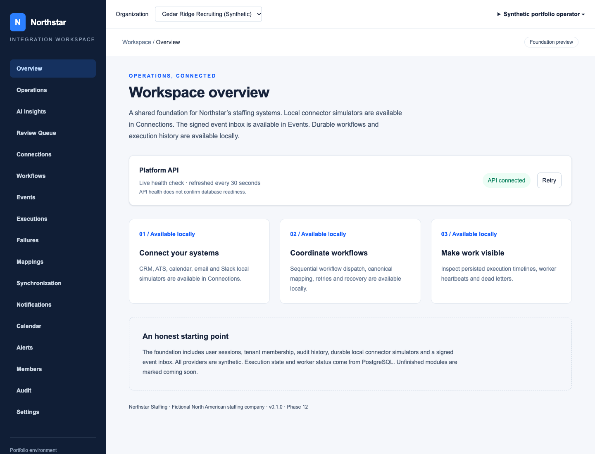
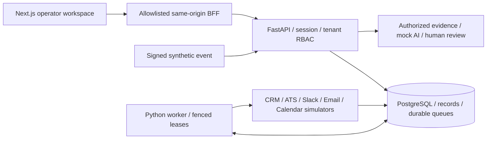
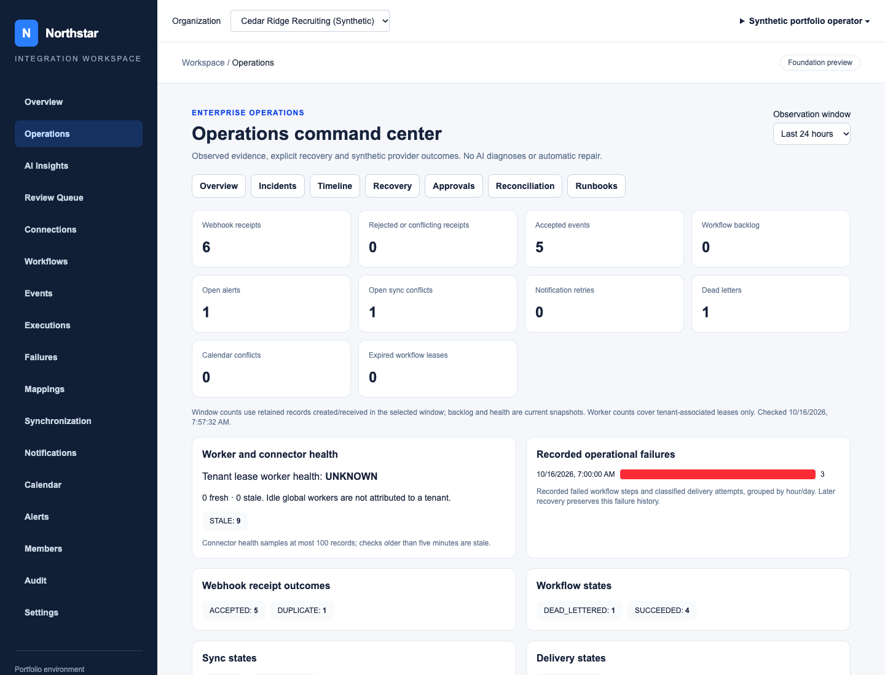

# Northstar Integration Platform

A working enterprise integration and AI workflow portfolio for a **fictional North American staffing company**. Sales requisitions move from CRM to ATS through signed events, versioned mappings and durable workflows. Disconnected systems force manual copying, hide partial failures and risk overwriting recruiter edits. Operators use this platform to inspect conflicts, recover individual failed actions and review evidence-grounded AI guidance.

**All demonstrated CRM, ATS, Slack, email and calendar effects are synthetic. AI uses a deterministic mock.** No customer deployment, real provider/OAuth verification or exactly-once remote delivery is claimed. Actual hosted CI results are linked below. Production release is blocked by disclosed dependency/image findings. [Read the public disclosures](docs/PUBLIC_RELEASE_DISCLOSURES.md).



## What works

| Area | Implemented behavior | Detail |
| --- | --- | --- |
| Identity / tenancy | Opaque sessions, membership/RBAC, CSRF/Origin checks, tenant-scoped queries and ownership constraints | [Threat model](docs/THREAT_MODEL.md) |
| Connectors | Typed registry and five durable local simulators; encrypted credential lifecycle | [Contracts](docs/CONNECTOR_CONTRACTS.md) |
| Webhooks | HMAC/timestamp validation, durable deduplication, signing-key rotation and inbox receipts | [Webhook security](docs/WEBHOOK_SECURITY.md) |
| Canonical data | Immutable mapping versions, external identities and field authority | [Data model](docs/CANONICAL_DATA_MODEL.md) |
| Workflows | Versioned sequential plans, PostgreSQL dispatch, leases/fencing, checkpoints and audit | [Engine](docs/WORKFLOW_ENGINE.md) |
| Reliability | Classified failures, persisted backoff/Retry-After, circuits, budgets, dead letters and explicit replay | [Retry / replay](docs/RETRY_AND_REPLAY.md) |
| CRM → ATS | Owned-field synchronization, revision checks, conflict holds and reconciliation | [Synchronization](docs/CRM_ATS_SYNCHRONIZATION.md) |
| Notifications | Transactional outbox; independent Slack/email delivery, receipts and targeted recovery | [Delivery](docs/NOTIFICATION_DELIVERY.md) |
| Calendar | Explicit synthetic create/reschedule/cancel, overlap checks and durable action history | [Coordination](docs/CALENDAR_COORDINATION.md) |
| Operations | Correlated incidents, timelines, consistency findings and governed recovery/approvals | [Command center](docs/OPERATIONS_COMMAND_CENTER.md) |
| AI / human review | Bounded authorized evidence, schema/citation validation, mock explanations; acceptance gives a preview only | [AI safety](docs/AI_RECOMMENDATION_SAFETY.md) |

Counts in the UI come from persisted synthetic records. The application does not fabricate operational metrics or real integrations. An ambiguous delivery is held for review; it is never blindly resent. Recovery preserves completed effects and still requires current authorization and any applicable independent approval.

## Architecture



**Stack:** Python 3.12, FastAPI, Pydantic, SQLAlchemy 2, Alembic, PostgreSQL 17, Next.js App Router, TypeScript, Tailwind CSS, pytest, Vitest and Playwright. Local development Compose runs PostgreSQL only; a separate release rehearsal runs API, worker, frontend and PostgreSQL. No Redis, message broker or paid API is required.

The local ATS write, identity association, sync receipt/state and notification intent share a PostgreSQL transaction. Channel delivery occurs afterward. Future remote providers cannot share that transaction and need provider-specific idempotency/reconciliation. [Eight source-controlled diagrams](docs/ARCHITECTURE_DIAGRAMS.md) explain the boundaries; [architecture](docs/ARCHITECTURE.md) and [decisions](docs/DECISIONS.md) give context.

## Run locally

Prerequisites: Python 3.11+ (3.12 tested; macOS Python 3.9 is insufficient), Node 22.12+ (24 tested), npm, Docker with Compose and Git. On an 8GB laptop, run builds and full suites sequentially. No paid accounts are needed.

Fresh checkout, repository root:

```sh
python3.12 scripts/setup_local.py
python3.12 -m venv backend/.venv
cd backend
.venv/bin/python -m pip install -r requirements-dev.lock
cd ../frontend
npm ci
cd ..
docker compose up -d --wait
cd backend
.venv/bin/alembic upgrade head
.venv/bin/python -m app.bootstrap
.venv/bin/python -m app.seed_demo
```

Setup exclusively creates private mode-600 env files and independent random secrets; it refuses overwrite. Bootstrap/seed prompt for synthetic operator credentials; do not put passwords in command arguments. Existing installations retain their env files, keys and database volume: upgrade migrations without resetting storage. [Environment setup](docs/ENVIRONMENT_SETUP.md) covers versions, examples, keys and limitations.

Start these in three terminals, each initially at the repository root:

```sh
# API
cd backend
.venv/bin/uvicorn app.main:app --host 127.0.0.1 --port 8000 --reload --no-access-log
```

```sh
# Durable worker
cd backend
.venv/bin/python -m app.workers.runner --poll-seconds 0.5
```

```sh
# Frontend
cd frontend
npm run dev
```

Open http://127.0.0.1:3000/login and choose **Cedar Ridge Recruiting (Synthetic)** after signing in. `GET /health` checks process health, `GET /ready` checks database connectivity (503 on failure), and `GET /api/v1/system/info` returns safe metadata. Open http://127.0.0.1:8000/docs for API contracts; authenticated UI calls use `/api/platform/*` → `/api/v1/*`. Private invitation delivery files are credentials: see [credential lifecycle](docs/CREDENTIAL_LIFECYCLE.md) and [runbooks](docs/RUNBOOKS.md).

## Demo and screenshots

Follow the [12-step walkthrough](docs/DEMO_WALKTHROUGH.md) for signed event ingestion → canonical transformation → durable workflow → ATS synchronization → partial notification failure → targeted retry → operations investigation → mock AI → human-reviewed preview. The separate localhost-only container rehearsal preserves the development database. [Release setup](docs/DEPLOYMENT_GUIDE.md) is configuration documentation, not a deployment claim.



[All 13 real Playwright screenshots and provenance](docs/assets/screenshots/README.md) · [Case study](docs/PORTFOLIO_CASE_STUDY.md) · [LinkedIn draft](docs/LINKEDIN_PROJECT.md) · [Upwork draft](docs/UPWORK_PORTFOLIO.md).

## Verification evidence

Recorded local Phase 12 results (2026-10-15 UTC), linked to [machine-readable evidence](docs/evidence/phase12-verification.json):

| Check | Recorded result |
| --- | --- |
| Backend | 653 passed, 0 failed/skipped; 2061.8 seconds; one TestClient warning |
| Frontend unit / browser | 157 / 28 passed |
| Mock AI contract evaluation | 60/60; not real-model accuracy |
| Ruff / ESLint / TypeScript / production builds | Passed locally |
| Container HTTP demo / restart-outage rehearsal | 13 / 6 checks passed |
| Backup / restore | 82 public tables matched counts/fingerprints; isolated restore |
| Remote GitHub Actions | Not run in Phase 12; new Phase 13B hosted results below |

**New hosted verification, 2026-10-16:** [Platform verification passed](https://github.com/zohaib-hyder/enterprise-integration-platform/actions/runs/38903952434) on code revision `d8347254da867f2cde89fc915dd010758884d2e0`: 653 backend tests, 157 frontend tests, 28 browser tests and 60/60 mock cases; Ruff, migrations/drift, ESLint, TypeScript and builds passed. Python/production npm audits reported zero known findings; the development audit still reports five high findings. [Publication report and CI fixes](docs/PHASE_13B_REPORT.md). The final documentation-only report commit skips duplicate CI and changes no tested application/workflow source.

Phase 13A preparation checks are dated separately in [its report](docs/PHASE_13A_REPORT.md). During Phase 13A, application business source was unchanged, so the long backend suite was not repeated then; the hosted Phase 13B execution above is separate. Browser accessibility evidence covers Overview at three viewports; it is not an application-wide certification. Bounded laptop measurements are [diagnostic baselines](docs/PERFORMANCE_BASELINES.md), not production throughput or an SLA.

To verify relevant changes locally:

```sh
cd backend
.venv/bin/pytest -q
.venv/bin/ruff check app tests alembic
.venv/bin/alembic current
.venv/bin/alembic check
cd ../frontend
npm run lint
npm run typecheck
npm test
npm run build
```

Database tests use unique test schemas; do not reset public data. See [browser setup](docs/BROWSER_E2E.md), [CI configuration](docs/CI_VERIFICATION.md), [backup/restore](docs/BACKUP_RESTORE.md) and [release readiness](docs/RELEASE_READINESS.md).

## Limits and release status

Real providers/OAuth, production TLS and Secure-cookie behavior, least-privilege deployment roles, scale and paid-model quality remain unverified/deferred. Phase 12 audits found zero known Python/production-npm issues but **five high development-tooling findings**. Image scans reported API/frontend each **0 critical / 1 high / 1 medium / 26 low**, PostgreSQL **4 / 31 / 27 / 10**. These dated findings remain open; no “production ready” or green remote-CI badge is used. [Exact scans](docs/evidence/phase12-container-scans.json) · [Disclosures](docs/PUBLIC_RELEASE_DISCLOSURES.md) · [Security gates](docs/PRODUCTION_SECURITY_CHECKLIST.md).

**Licensed under [MIT](LICENSE), copyright (c) 2026 Zohaib Hyder.** [License/asset status](docs/LICENSE_STATUS.md). Phase 13B authorizes public source publication under `zohaib-hyder` and remote CI. Initial staged-file checks and actual publication/CI results are recorded in the current report. Portfolio posting and deployment remain unauthorized. [Current Phase 13B status](docs/PHASE_13B_REPORT.md). [Publication checklist](docs/PUBLICATION_CHECKLIST.md).

[Documentation index](docs/README.md) · [Implementation phases](docs/IMPLEMENTATION_PLAN.md) · [Portfolio scope](docs/PORTFOLIO_SCOPE.md).
