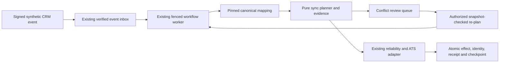
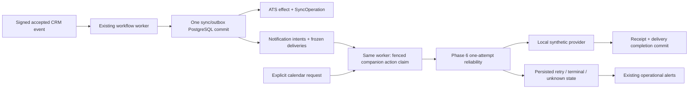
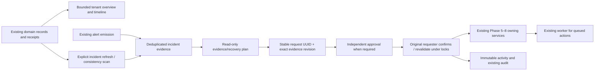

# Architecture

Northstar Staffing is a fictional North American staffing agency. Sales teams maintain client accounts in a CRM; recruiters own candidates, requisitions and placements in an ATS. Interview coordination spans calendars, email and Slack, causing duplicate entry and missed handoffs. All portfolio fixtures will be synthetic.

## Foundation runtime

Browser → Next.js App Router → same-origin `/api/health` probe → FastAPI `/health`.
FastAPI `/ready` → SQLAlchemy 2 engine → PostgreSQL. Alembic controls schema changes separately from application startup. Next and FastAPI run as local processes; Docker hosts PostgreSQL only. Frontend `BACKEND_URL` is server-only. No provider calls occur.

`api` owns HTTP contracts, `schemas` owns response validation, `core` owns configuration, `db` owns connections, and `models` owns persistence. `services` enforces authenticated business transactions; `connectors` owns explicit versioned adapters and local simulator implementations. `workflows` owns durable dispatch/execution and `workers` owns the foreground worker.

## Ownership and integration boundaries

Planned source-of-truth rules: CRM owns client/account and sales contact fields; ATS owns candidates, requisitions, submission stages and placements; calendar owns meeting time and attendance response; email owns delivery/thread state; Slack owns notification delivery only. The platform owns mappings, normalized events, workflow definitions, execution state and audit evidence. It must not become a second ATS. Field-level mapping will specify authority before writes; ambiguous ownership must be surfaced rather than silently resolved by last-write-wins.

Future adapters translate provider-specific payloads to versioned internal contracts. Local simulators come first; real OAuth and external APIs are out of scope now. Provider IDs will be namespaced by tenant and connector. Slack messages cannot authorize business state changes by themselves.

## Transactions and delivery

The original tenant registry remains intact; Phase 1 adds identity and access-management transactions. UUIDs are generated in the Python ORM; the migration has no server UUID default. PostgreSQL timezone-aware timestamps use server creation defaults; ORM updates set `updated_at`. Raw SQL writers must explicitly update that column. Unique slug index enforces uniqueness; created-at index supports future chronological listing.

Future ingestion will persist event + deduplication key + outbox record in a single local database transaction. External network calls will never share an open database transaction. Delivery will be at least once, with idempotency keys, bounded retries and reconciliation. There is no claim of cross-provider atomicity or exactly-once delivery. Workers and durable queues will be designed later, without assuming Redis is required.

## Safety and limits

Health checks process responsiveness; readiness checks `SELECT 1`, not schema version or provider health. Engine connections are lazy with a small pool and a three-second connect timeout. Config defaults to no CORS origins; examples permit only the local frontend. Credentials are secret-wrapped and omitted from metadata. Request logs include only method, route template, status, elapsed time and validated/generated UUID correlation ID. Bodies, query strings, arbitrary paths and exception details are omitted. Production hides OpenAPI endpoints and requires database config and HTTPS CORS origins.

Phases 1–2 implement authentication, application-level tenant isolation, authorization and local simulator connections. Real provider integrations, workers, workflow execution records, LLM features and operational metrics remain unimplemented. The application stays local; no CI is enabled yet.

## Phase 1 authentication and frontend integration

Browser → Next.js allowlisted `/api/platform/*` BFF → FastAPI versioned API → PostgreSQL identity tables. The browser sees same-origin cookies and JSON. The BFF forwards only platform cookies and verification/correlation headers, never invents a valid Origin or authenticates users itself. Unknown routes/unsafe query keys are rejected, request bodies are capped at 16KiB, redirects are refused and upstream requests have bounded timeouts. The backend remains the security boundary even when called directly.

Passwords use Argon2id (64MiB, three iterations, one lane), random salts and parameter-upgrade rehashing after verified login. Unknown users perform dummy verification; inactive users and wrong passwords receive identical errors. PostgreSQL upsert counters implement account and remote-IP fixed-window limits across API processes. Behind this local BFF, all browsers share its IP bucket; forwarded-IP headers are deliberately untrusted. Counters contain SHA-256 identifiers, not raw email/IP values. Rate-limit expiration cleanup runs during login.

Login issues a fresh 256-bit opaque random session token, storing only SHA-256(token) in PostgreSQL. Responses never serialize the token or hashes; the token travels in a HttpOnly cookie. Sessions have fixed absolute expiry (eight hours by default), last-seen time, revocation and server-side active tenant. Existing same-user browser sessions rotate on login. Logout revokes the session before clearing cookies. A user can revoke only an owned session. Auth checks inactive users, expiry and revocation on every request. There is no sliding expiry or password reset yet.

Both cookies use SameSite=Strict, Path=/, no Domain and HttpOnly. Production adds Secure and `__Host-` prefixes; HTTPS authentication origins and a persistent CSRF secret are required by configuration. Local development uses HTTP-compatible host-only cookies. Session tokens are never placed in localStorage, browser-readable application state or URLs.

CSRF protection combines an exact Origin allowlist, rejection of cross-site Fetch Metadata, and a session-bound HMAC-signed double-submit value. `/auth/csrf` sets a HttpOnly cookie and returns only its short-lived request-verification value; the browser holds that value transiently and sends `X-CSRF-Token`. The backend validates header/cookie equality, signature, session binding and one-hour lifetime with constant-time digest comparisons. Login uses anonymous binding; successful login clears the old CSRF cookie and subsequent verification binds to the new session. Logout and invitation acceptance receive the same protection. `CSRF_SECRET` is ephemeral per process in local development if omitted; production requires a stable generated environment secret shared by workers. CORS never substitutes for CSRF. [OWASP CSRF guidance](https://cheatsheetseries.owasp.org/cheatsheets/Cross-Site_Request_Forgery_Prevention_Cheat_Sheet.html) informed this design.

## Tenant isolation and permission matrix

Clients can propose a tenant UUID, but only active membership grants context. A stored active tenant is reverified on every scoped request. List queries always filter the authorized tenant; target member/invitation lookups include both target ID and tenant ID. Tenant denials use generic errors. User email/password identity is global; role and status belong to each membership. Revoking membership does not destroy identity or access to another authorized organization. `/auth/me` lists only the user's own memberships, exposes names only for active authorized tenants, and returns effective permissions.

| Permission | Tenant admin | Integration engineer | Operations user |
| --- | --- | --- | --- |
| Tenant information | Yes | Yes | Yes |
| Organization-name settings | Yes | No | No |
| Members/invitations | Yes | No | No |
| Tenant audit | Yes | No | No |
| Connection management and simulator execution | Yes | Yes | No |
| Future operational read | Yes | Yes | Yes |

Dependencies `require_authenticated_user`, `require_tenant_membership`, `require_tenant_role` and `require_tenant_permission` are reusable. Mutating services recheck authorization after locking the tenant parent row; UI permissions are for usability only. Integration-management permissions now govern connection mutations, health checks, operation execution and synthetic record inspection. PostgreSQL RLS is not configured; application services must retain explicit tenant filtering as new tables arrive.

## Identity transaction boundaries and audit

Successful login commits the session and audit event together. Failed/rate-limited login intentionally commits counters and sanitized audit before raising a generic error. The database dependency uses FastAPI function scope so commit completes before sending a successful response or cookie. A forced commit-failure regression verifies no authentication cookie is returned on failure. [FastAPI dependency scope](https://fastapi.tiangolo.com/tutorial/dependencies/dependencies-with-yield/#early-exit-and-scope) defines this lifecycle.

Membership mutations lock the tenant row, revalidate the actor, and count active administrators with active identities before removing/demoting an effective last administrator. Invitation create/revoke/accept use the same parent lock ordering. Acceptance locks the invitation and obtains a transaction advisory lock keyed by normalized email to serialize account creation across tenants. Account creation, membership, token consumption and audit are one database transaction. Concurrent acceptance allows one success; concurrent administrator demotion preserves one admin.

Invitation tokens are random 256-bit bearers stored only as hashes. Existing identities must authenticate as the invitee; a token cannot reset their password or create a second account with the same email. New accounts derive email and role only from the invitation. Delivery is a private repository-local filesystem adapter, not a functioning email provider. Tokens are never returned in API responses or embedded in links. Delivery files are created before database commit; a commit failure can leave an unusable orphan file. This filesystem/database boundary cannot be atomic; durable email outbox delivery is future scope. Files remain private after expiry/revocation and require operator-managed retention.

Audit rows allow only enumerated metadata values (roles, membership statuses, fixed failure reasons), excluding raw credentials, emails, request payloads and tokens. Authentication events have null tenant attribution; tenant changes, invitation and membership events use the authorized tenant. Global authentication events are persisted but not exposed through tenant audit APIs. UUID actor/target IDs remain available for correlation. Audit retention and tamper-resistant export are future scope.

## Phase 2 connector runtime and persistence

Browser Connections page → allowlisted same-origin BFF → authenticated `/api/v1/connections` service → explicit connector registry → typed simulator → SQLAlchemy/PostgreSQL. Operation names select a fixed payload model; inputs and outputs validate before crossing the adapter boundary. Registry entries are code-owned, never import paths or user plugins. The six global connector definitions are an additive migration snapshot; runtime capability schemas come from registered code.

Each connection has an explicit tenant FK, type, safe version-1 public configuration, enabled status and last local health result. Five synthetic tables store business payloads, messages and calendar events with explicit tenant FKs and composite `(connection_id, tenant_id)` ownership FKs. UUID target lookups always include tenant and connection. External record IDs are unique per tenant/connection/kind; they do not imply CRM/ATS identity equivalence. There is no cross-system sync or inferred mapping.

Connection create/update locks the tenant parent and revalidates membership. Execution locks the connection row, validates enabled status and its current configuration, and persists the operation and sanitized audit in one local transaction. Delivery keys are unique per tenant/connection; identical canonical payloads return the original identifier, changed payloads conflict. The connection lock serializes concurrent sends, upserts and calendar conflict checks across database sessions. Calendar intervals are half-open; adjacent events are allowed, cancelled bookings do not block, and overlaps are enforced per connection/calendar. Creation retries return current event state even after a later update/cancel.

These locks are appropriate for small local operations; they are not an architecture for slow external provider requests. Future providers must separate durable intent/outbox transactions from transport and reconcile failures without claiming distributed atomicity. Database uniqueness protects local idempotency; there are no automatic retries or workflow executions. Calendar overlap protection is application-enforced under a row lock, not an exclusion constraint; raw SQL writers could bypass it. Direct adapter calls are trusted internal code and must receive an authorized context through services.

Configuration rejects all unknown keys, credentials, URLs and headers. CRM/ATS have a workspace label; Slack/calendar choose fixed synthetic destinations; email recipients must use reserved `example.test` domains and match the connection's allowlist. Text names are user-entered synthetic demo data and are escaped by React. API serialization excludes delivery keys/fingerprints and auth secrets. Connector errors are fixed classifications, not raw exception strings. Audit stores action and UUID attribution without business payload/config contents.

All five simulators make no network calls. Generic REST is intentionally disabled at configuration, database constraint and adapter execution boundaries. It has no URL/header fields, DNS resolver, redirect handling or HTTP transport; safe allowlisted DNS-pinned execution is deferred. Health reports local simulator availability and never claims real provider connectivity. See [contracts](CONNECTOR_CONTRACTS.md) and [catalog](INTEGRATION_CATALOG.md).

## Phase 3 signed ingress and durable inbox

Public synthetic sender → bounded raw-body FastAPI ingress → endpoint-scoped timestamp/HMAC verifier → validated business envelope → locked endpoint transaction → PostgreSQL accepted event + receipt. Browser Events → existing session/CSRF BFF → tenant-authorized endpoint lifecycle and redacted read APIs. The BFF does not proxy public ingress and cannot choose a tenant or destination.

A dedicated 32-byte environment master key encrypts signing secrets with AES-256-GCM and context-bound authenticated data. Each endpoint owns one connection and tenant through composite FKs. Current/immediately previous signing versions have bounded eligibility; rotation serializes with ingestion. There is no plaintext secret in connection configuration, no read-secret API, and one-time disclosure happens only after a successful management commit.

Accepted state and future processing state are separate (`ACCEPTED`, `PENDING`). Endpoint/source/provider-event identity has a database uniqueness constraint. Identical canonical validated payloads acknowledge the same event; conflicting retries retain the original and create a safe conflict receipt. Authenticating raw bytes is distinct from normalized-payload deduplication. Acknowledgements wait for commit. Schema-rejected signed attempts have safe receipts without content; unauthenticated attempts never become tenant inbox data.

No event triggers simulator mutations, sync, workflow execution, background work or external communications. The manual CLI only targets pinned numeric loopback on port 8000. UI simulation is explicitly authorized and in-process. Existing identity/connector transactions and persistent data are retained. See [webhook security](WEBHOOK_SECURITY.md) and [inbox contracts](EVENT_INBOX.md) for protocol, key custody and remaining abuse-control limits.

## Phase 4 canonical normalization

Explicit authenticated BFF action → authorized stored mapping/version → pure source validation/allowlisted field operations → canonical entity validation → identity resolution and authority/order evaluation → atomic record/identity/attempt/evidence transaction. An accepted event supplies its preserved validated payload, connection and occurrence time; normalization never edits the inbox or creates a workflow execution.

Seven new tenant-scoped tables use JSONB and composite ownership FKs. Mapping versions are immutable through a PostgreSQL trigger, and activation has a deferred version FK. Tenant/connection/kind/external-ID uniqueness makes identity namespaces explicit; additional links require a manager action. Canonical records preserve primary provenance and per-field owning source/version/time/attempt, with revision counters for actual business changes.

Tenant and record locks prevent lost updates. Changed fields require code-owned authority and fresh source time; stale/equal conflicting or ambiguous updates retain evidence rather than overwrite. Success and evidence commit before response. Preview writes no business state. Invalid snapshots are bounded/known-field-only and never exposed raw; read representations redact sensitive keys. Missing/unsupported mapping versions fail safely before normalization. No network I/O occurs in transformation transactions.

See [canonical model](CANONICAL_DATA_MODEL.md), [engine](TRANSFORMATION_ENGINE.md), [identity](IDENTITY_MAPPING.md) and [authority](FIELD_AUTHORITY.md). This is manual local normalization, not automatic synchronization or an execution engine.

## Phase 5 durable execution boundary

PostgreSQL now owns immutable workflow versions/triggers, dispatch receipts, executions/steps/history, retry schedules, dead letters, infrastructure heartbeats and action receipts. FastAPI manages tenant-authorized plans and recovery; a separate foreground worker dispatches accepted inbox events and claims due/stale work with SKIP LOCKED. Next.js retains its authenticated BFF and strict route/filter/body bounds for Workflows, Executions and Failures.

Dispatch creation and its receipt are one transaction. Claim/attempt/lease fencing is a short separate transaction. A bounded local mock effect, APPLIED receipt and validated checkpoint commit atomically under tenant then execution locks; failure rolls back before separate fenced retry/dead-letter persistence. Delays/polling occur outside transactions. Source identity and authorization derive from stored tenant ownership and the creator's current membership, never payload fields. Operations recovery does not grant plan editing or principal impersonation beyond the captured workflow's authorized scope.

Phase 3 incoming_events stays accepted/PENDING as immutable ingestion evidence; workflow_dispatch_records is the workflow consumption authority. A no-match event can be explicitly rescanned; dispatched events are never silently rerun for newer versions. Concurrent workflows may match one event, but each has distinct execution/receipt ownership. Completed steps survive lease recovery/replay. Replay preserves root and parent lineage and refuses uncertain actions. Real provider effect/checkpoint atomicity is impossible; provider idempotency and reconciliation are future requirements. The coarse tenant lock is a documented throughput limitation, not a scale claim.

Workflow behavior, state machine, API inventory and source-of-truth/transaction boundaries are specified in [WORKFLOW_ENGINE.md](WORKFLOW_ENGINE.md). No full ATS synchronization or authority override is added.

## Phase 6 reliability and operational evidence

Eleven additive tables extend the existing PostgreSQL boundary: connection reliability policies; tenant/connector/connection rate policies/windows; persistent breakers/transitions; encrypted credential generations and refresh outcomes; explicit local fault scenarios; connector observations; deduplicated alerts/lifecycle history. No new infrastructure is required. The same tenant membership/Origin/CSRF checks protect BFF mutations; operations inspection never returns credential values or probe/lease tokens.

A connector call has one bounded attempt. The PostgreSQL server clock and tenant/connection row locks atomically coordinate all quota scopes and half-open ownership. Local effects execute in a savepoint; their failure rolls back the effect but permits the outer transaction to retain sanitized admission/refresh/breaker/telemetry and workflow retry state. API error responses deliberately commit this evidence through the existing function-scoped dependency. Unexpected/unpersistable database ownership failures may have no observation and are never backfilled as fabricated metrics. Successful mock effects/receipts/checkpoints retain Phase 5 atomicity and root idempotency.

Credential AES-GCM binds tenant, connection, UUID, type, generation and key reference; dedicated configuration/key history is distinct from webhook encryption. Local OAuth-style refresh is serialized and rotates both tokens without disclosure or external transport. Persistent quotas/breakers survive worker restart. Policy/credential replacement invalidates previous health samples; health checks cannot override required encryption/credential failures or an open breaker.

Metrics are retained actual observations plus existing workflow history, never distributed tracing or inferred throughput. Alerts are in-platform, tenant-scoped and source-deduplicated. Admin/engineer resolve; operations acknowledge only. Lazy TTL/cap cleanup touches Phase 6 telemetry/windows, not existing business/canonical/inbox/workflow/credential/audit data. Future external effects require admission/outbox/unknown-outcome boundaries rather than extending a database transaction over network I/O. See the three Phase 6 documents for actual algorithms and limits. Full CRM-to-ATS synchronization remains Phase 7.

## Phase 7 synchronization transaction boundaries

`api/synchronization` uses the existing tenant/session/CSRF permissions and exact Next BFF routes. `services/synchronization` gathers canonical/identity/authority evidence, invokes a pure planner and persists immutable plans. Configuration activation creates a Phase 5 workflow with PLAN_CRM_ATS_SYNC → APPLY_CRM_ATS_SYNC → RECORD_SYNC_OUTCOME. The original worker is the sole dispatch, lease, checkpoint and retry architecture.

Planning normalizes verified source events with the pinned Phase 4 mapping. Apply rechecks configuration, source high-water time, current source/destination digests, authority and identity under tenant→destination connection locks. Phase 6 admits the Phase 2 ATS upsert. Provider effect, external identity, sync operation receipt and fenced checkpoint share a database commit; reliability failures roll back effects in a savepoint and retain durable retry/admission evidence. This is a local synthetic transaction guarantee, not a distributed provider transaction.

Conflict decisions are durable sync HELD states. The planning workflow can complete after recording a hold without claiming an ATS write. Authorized review uses optimistic source/destination/revision guards and seeds a re-planned checkpoint into the same worker. Read-only reconciliation persists bounded page evidence and counts, with optional preview generation; it neither silently repairs providers nor adds a scheduler. See CRM_ATS_SYNCHRONIZATION.md, SYNC_CONFLICT_RESOLUTION.md and RECONCILIATION.md for full contracts.

## Phase 8 transactional outbox and companion action queue

The local sync transaction now commits its authoritative ATS outcome and all explicitly matched notification intents together. Each immutable template/rule version is pinned into an intent and its frozen rendered payload. Independent action transactions perform Slack/email/calendar operations through Phase 6, committing local provider effect, orchestration receipt and delivery completion atomically. Phase 7 and Phase 5 receipts remain responsible for their own domains. Notification failure cannot call or roll back ATS synchronization.

The worker alternates workflow work and one companion action in each poll cycle. It reuses existing WorkerLease, RetryPolicy/backoff and connector reliability controls; no independent scheduler/worker service is added. Unknown timeout outcomes require verified provider receipt/hash evidence. Calendar update/cancel cannot be confirmed by current field equality alone. Coarse tenant/connection locking is suitable for the local portfolio workload, with bounded I/O-free adapter transactions and no claims of remote exactly-once behavior. See the Phase 8 domain documents for state and security contracts.

## Phase 9 operations metadata and governance

Operations projects existing tenant-owned receipts, histories, sync outcomes, deliveries and alerts. Seven additional tables store incident/evidence/activity, recovery requests/approvals and read-only scan runs/findings. Ten tenant/correlation/time indexes support provenance reads. Existing correlation IDs plus explicit FK traversals establish links; time similarity is never a join condition. Global workers are only counted through tenant-associated current leases.

No additional daemon, scheduler, retry engine, provider, paid service or AI is introduced. Operational state does not replace business state: a queued replay is not successful completion, an acknowledged incident is not resolved delivery, and approval is not action receipt proof. Existing domain endpoints keep their original safety/authorization contracts; the additional approval workflow governs command-center requests. See the Phase 9 domain documents for metrics definitions, transaction boundaries and explicit limitations.

## Phase 10: advisory AI boundary

Eight additive AI metadata tables sit beside the Operations domain. Fixed tenant-scoped
retrieval → redacted bounded evidence → configured provider (mock default) → strict extractive
schema/citation/action validation → stored explanation/recommendations → manager review.
Current evidence plus the existing planner determine eligibility. Human acceptance returns
only an internal recovery preview handoff. Existing request/confirmation/independent approvals
and owning services remain the action boundary; AI cannot call them. No second engine,
worker, vector database, Redis or autonomous tool loop exists. Each provider call is bounded
and may fall back once to a clearly labelled local mock. See [AI_ASSISTANCE.md](AI_ASSISTANCE.md)
for transactions, retention, provider configuration and exact API inventory.

## Phase 11 hardening

Phase 11 adds direct API body and Host restrictions, bounded local webhook ingress protection, security response headers, Tenant-before-queue lock ordering, targeted dependency remediation, browser/axe verification and bounded performance/fault harnesses. Existing business services, approvals, idempotency and encrypted credentials are retained. No schema migration is added; head remains `e8e0abf289b1`.

See [Phase 11 report](PHASE_11_REPORT.md), [security findings](SECURITY_AUDIT.md), [browser setup](BROWSER_E2E.md), [performance evidence](PERFORMANCE_BASELINES.md) and [production release gates](PRODUCTION_SECURITY_CHECKLIST.md). Verification uses retained isolated synthetic schemas; no public data reset or deployment. One high development-tooling advisory remains open; production readiness is conditional on the documented gates.

## Phase 12 release boundary

The original PostgreSQL-only development Compose file is unchanged. Separate release Compose adds the same API/worker services and standalone frontend with project-scoped volumes. Internal application/database networks isolate PostgreSQL; a separate edge network permits localhost frontend access and optional rehearsal API ingress. No paid transport or real provider is enabled. Images carry code/locked dependencies only; runtime environment supplies independent secrets. Production validates keys, CSRF secret, exact hosts, HTTPS origins and no debug. Local HTTP rehearsal deliberately uses test mode; TLS/proxy/least-privilege DB roles/key custody remain deployment gates.

Backups cover all public application tables, excluding retained verification schemas, and restore only to a new generated database in the separate project. Counts/fingerprints plus representative ORM reads verify recovery; matching external key material is still needed to decrypt credentials. The worker's optional health marker identifies its exact lease; another healthy worker cannot mask a stopped/stale one. Readiness remains DB connectivity, with explicit migration validation before startup. See DEPLOYMENT_GUIDE.md, BACKUP_RESTORE.md and PHASE_12_REPORT.md.
