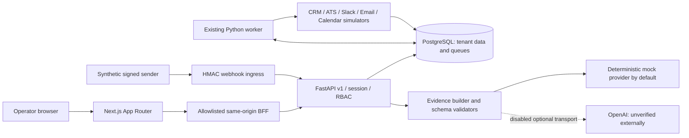
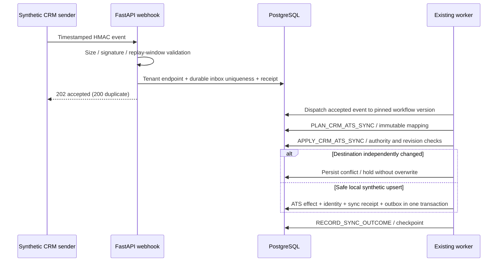
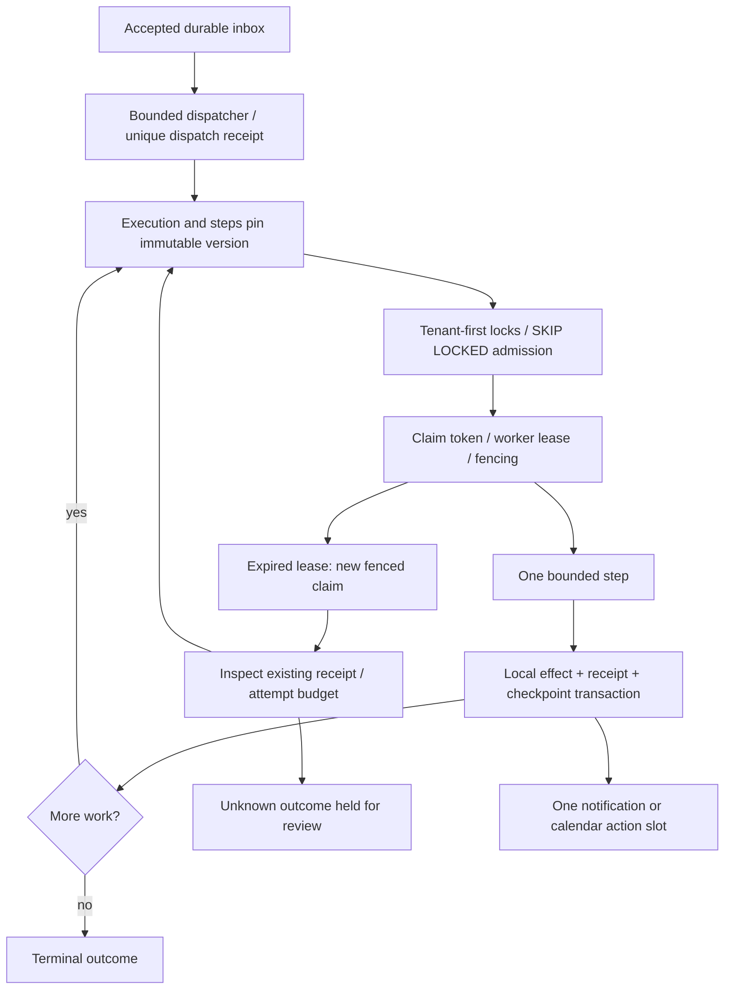
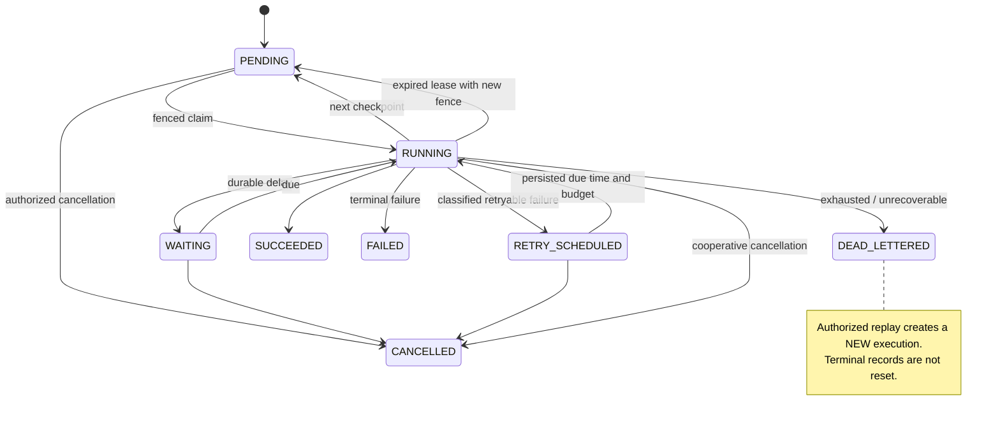
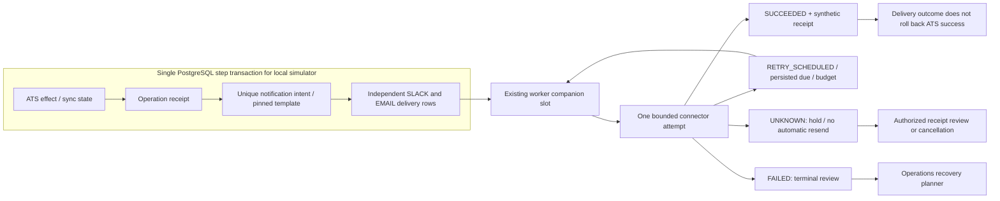
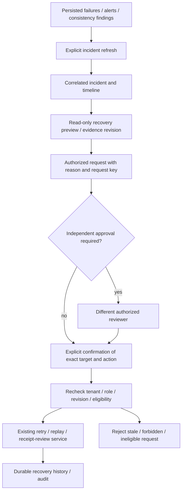
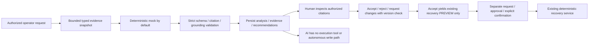
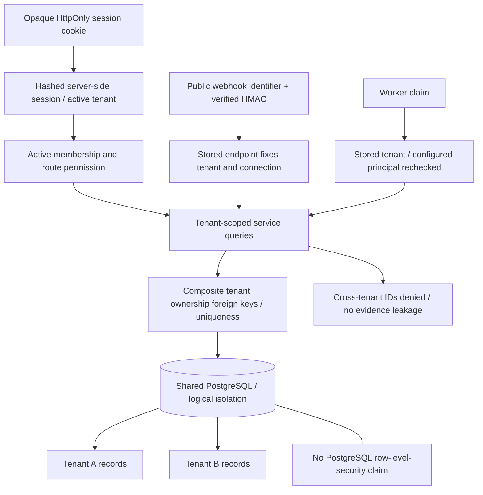

# Architecture diagrams

These describe the implemented local system. All provider effects shown are synthetic; optional external AI is disabled. PostgreSQL transactions do not extend across a future remote provider.

## System

[Mermaid source](diagrams/system.mmd)

## Webhook To Ats

[Mermaid source](diagrams/webhook-to-ats.mmd)

## Durable Worker

[Mermaid source](diagrams/durable-worker.mmd)

## Retry State Machine

[Mermaid source](diagrams/retry-state-machine.mmd)

## Notification Outbox

[Mermaid source](diagrams/notification-outbox.mmd)

## Incident Recovery

[Mermaid source](diagrams/incident-recovery.mmd)

## Ai Human Review

[Mermaid source](diagrams/ai-human-review.mmd)

## Multi Tenant Boundary

[Mermaid source](diagrams/multi-tenant-boundary.mmd)

Implementation references: [workflow engine](WORKFLOW_ENGINE.md), [synchronization](CRM_ATS_SYNCHRONIZATION.md), [notification delivery](NOTIFICATION_DELIVERY.md), [recovery governance](CONTROLLED_RECOVERY.md), [AI safety](AI_RECOMMENDATION_SAFETY.md), [threat model](THREAT_MODEL.md).
