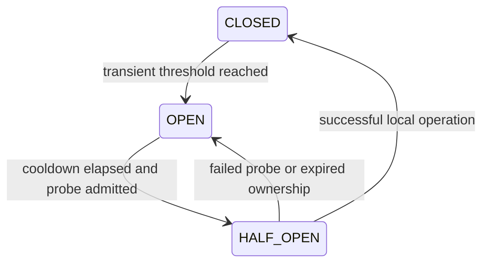

# Connector reliability (Phase 6)

Northstar’s local CRM/ATS/calendar/email/Slack adapters now share a single-attempt execution layer. It provides persistent admission budgets, a connection breaker, simulated credential authorization/refresh, explicit local fault scenarios and sanitized observations. No transport to a real provider, Redis or additional service is introduced. Full CRM-to-ATS synchronization remains Phase 7.

## Retry ownership and transaction boundaries

`integrations.execute` calls `services/reliability.execute_once`. An explicit one-off API operation performs **one attempt**, including mutations. There are no retry loops, sleeps or automatic replays in this layer. A classified error returns an operation UUID, correlation UUID, safe reason/category, retryable flag and optional Retry-After. The caller must make another explicit request; non-idempotent actions are never automatically repeated.

For workflows, the layer returns `ReliabilityError` scheduling metadata. Phase 5 persists the retry schedule and due time. Explicit connection policies cap attempts against the step policy; unconfigured connections retain Phase 5 step retry behavior. Positive exponential jitter remains bounded by policy. Retry-After is a separate floor on the persisted due time, capped at 300 seconds, so a local window reset/cooldown is honored even when the normal backoff cap is smaller. Deferrals consume the bounded step attempt budget. Exhaustion follows the existing FAIL/DEAD_LETTER behavior.

Transactions:

1. The caller acquires tenant/connection locks and atomically decides all quotas, breaker admission, fault consumption and credential lifecycle. Workflow ownership has already checked its execution fencing token and cancellation flag.
2. A savepoint surrounds the bounded local adapter effect. Validation, SQL/read timeout, unexpected adapter failure or exceeded overall deadline rolls back that effect.
3. The outer transaction retains sanitized failure observations, counters, breaker/refresh outcomes and alerts. The one-off endpoint returns an error response so its normal database dependency commits this evidence. The worker handles the classified error inside the owned transaction, persisting retry/dead-letter state with that same evidence.
4. Successful local effects, workflow action receipts and checkpoints still commit together. Completed checkpoints/receipts bypass connector admission and do not spend quota or repeat business actions.

No transaction is held while polling or sleeping. All adapters are local PostgreSQL operations. Future external provider I/O must use different admission/effect/checkpoint boundaries and provider idempotency/reconciliation; an external effect cannot participate in a PostgreSQL savepoint. There is no external exactly-once claim.

## Timeout and cancellation policy

Policies bound connect/lock acquisition (50–3000 ms), SQL read statements (50–5000 ms), and admission plus local adapter deadline (100–10000 ms). Connect/read budgets cannot exceed overall. A workflow’s step deadline also applies; the maximum local operation remains below its minimum lease. Because no outbound network connection exists, **connection timeout is a real database lock-acquisition budget**, read timeout is a SQL statement budget, and network timeout scenarios are explicit local failure classifications. Simulated timeouts do not fabricate waiting time; recorded latency measures actual elapsed local processing.

SQL savepoints keep the caller’s transaction usable after statement timeout. Overall deadline expiry after a local write rolls back that write. Evidence persistence/retention and transaction commit are database work after the adapter deadline; this is not a remote end-to-end SLA. If the database/tenant lock cannot be acquired, no effect/quota commits, and a classified error may have no persisted observation. Metrics never invent that missing evidence.

Cancellation remains cooperative before the owned step; already committed actions are retained. Tenant and execution locks plus token/lease checks prevent concurrent cancellation from changing step ownership during a local effect. Lease expiration rolls back the enclosing effect/checkpoint transaction. Normal recovery never repeats completed steps. Future long-running external calls need separate cancellation and unknown-outcome handling.

## Atomic fixed-window quotas

Three policies apply to every connector request: TENANT, CONNECTOR and CONNECTION. Defaults are 10000, 5000 and 5000 per 60 seconds. Connector quotas are **per tenant and connector type**, not a global shared quota across companies. Budgets support limits 1–100000 and windows 1–120 seconds. Management endpoints and diagnostics are outside these operation budgets.

The PostgreSQL server clock determines UTC fixed-window starts. Tenant locking coordinates all three checks/increments across workers. If any scope is exhausted, no scope increments; the error reports the largest required reset delay. Circuit-denied operations do not spend quota. Once admitted past those gates, a failed credential check or synthetic/provider attempt spends its quota, preventing unbounded authentication attempts. Status reports actual used/remaining/reset values. Configuration does not delete existing counters; a changed window length changes its alignment. Fixed windows permit boundary bursts and are not a sliding-window algorithm. Coarse tenant locking is a throughput limitation; no benchmark is claimed.

## Persistent circuit breaker



A connection row stores state, consecutive transient failures, operational failure count, cooldown and private probe token/expiry. Only one probe can own a connection under tenant/connection row locks. A pending persisted probe suppresses other attempts until its expiry. During the normal local effect transaction, HALF_OPEN and its completion are atomic; a crash rolls back to the previous durable OPEN state. Worker restart never resets breaker state. Sanitized transitions are stored and auditable.

Timeout/unavailability and explicit synthetic HTTP 500/503 count toward the transient threshold. HTTP 401/403 are permanent authentication/authorization failures. HTTP 429 defers and does not trip the breaker. Unexpected INTERNAL_ERROR is permanent, while the explicitly injected HTTP_500 scenario is retryable. Business validation/not-found/conflict errors do not mark a connection unhealthy. A failed half-open probe returns to OPEN even if its permanent result cannot establish recovery. Healthy operations close a probe, clear failure counters and resolve applicable health alerts. Policies/credential replacements invalidate the previous health sample; a configuration health check cannot override an open breaker or unavailable credential encryption.

## Fault injection

Only admins/integration engineers can configure tenant-owned local CRM/ATS faults. Disabled by default, they have 1–10 attempts and a 10–3600 second TTL. Atomic consumption survives worker restart. Scenarios: HTTP_401, HTTP_403, HTTP_429, HTTP_500, HTTP_503, CONNECT_TIMEOUT, READ_TIMEOUT, RECOVERING_OUTAGE, EXPIRED_ACCESS_TOKEN, REVOKED_REFRESH_TOKEN and REFRESH_FAILED. Token scenarios require an explicit simulated OAuth mode and stored token pair. No arbitrary URL, response body, code or secret is accepted. Configuration is audited; simulated failures are persisted as actual local outcomes, not fake historical metrics.

## APIs and demonstration

All paths below start with `/api/v1`; mutations retain Origin/CSRF and integrations:manage.

- GET/PUT `/connections/{id}/reliability`
- GET `/connections/{id}/health-details`
- GET/PUT `/connections/{id}/rate-limits`
- GET `/connections/{id}/circuit` and `/circuit/history`
- GET/PUT `/connections/{id}/failure-injection`
- Existing POST `/connections/{id}/execute` uses the shared layer; Retry-After and X-Operation-ID pass through the BFF.

Run API, built frontend and PostgreSQL using README commands. From `backend`:

```sh
# Private synthetic operator credentials are prepared by the existing Phase 1 verifier.
PYTHONPATH=. .venv/bin/python ../scripts/verify_phase6_http.py
```

Each run retains a uniquely named synthetic evidence set. It starts/stops only its own workers, submits signed localhost webhooks, verifies real rate-limit/durable retry/restart, persisted OPEN and half-open recovery, encrypted refresh/revocation failure, duplicate action suppression, alerts/metrics and tenant denial. No database resets, provider requests or external communications occur.
