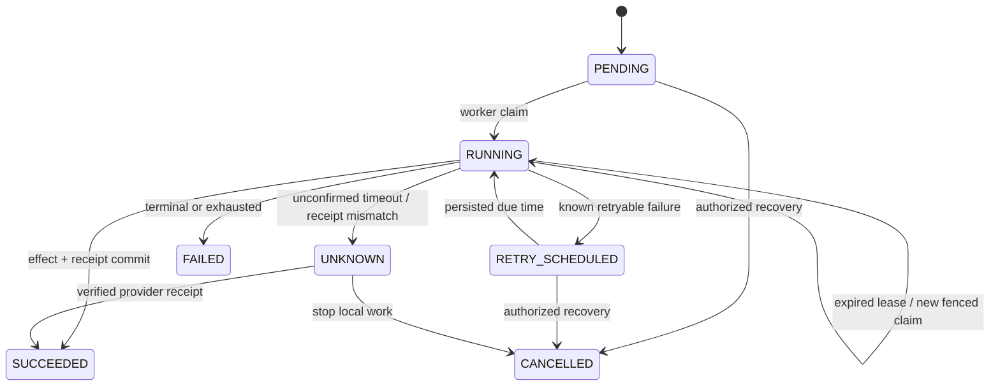

# Durable synthetic notification delivery

Phase 8 delivers only to the PostgreSQL Slack/email simulators. `SUCCEEDED` means a synthetic provider effect and a sanitized receipt committed; it does not mean a real person received a message. Destinations are restricted to configured recruiting/operations/alerts channels or explicitly allowed `example.test` recipients.

## Templates and rules

Templates have SLACK or EMAIL channels. Every version is immutable immediately, including drafts; editing creates another numbered version. Activation selects a version for new rule configurations. Existing rules and intents retain their pinned version when a template is later activated. Rule behavior also has immutable numbered versions; enable/disable uses optimistic rule revisions. Rules are disabled by default.

Placeholders are exactly `job_title`, `requisition_reference`, `client_display_name`, `sync_outcome`, `correlation_id`, and `review_reference`. Only brace substitution is supported. HTML, external URLs, malformed placeholders, attribute access and executable syntax are rejected. Rendering escapes markup, neutralizes Slack mentions, and bounds final Slack text to 2,000 characters, email subject to 200, and email body to 4,000. Email bodies are escaped text; this is not an HTML mail composer. Subjects remain single-line. Inputs reject secrets, control characters and external URLs. Automatic input selection takes only named canonical business fields, never the raw webhook body; suspicious values are redacted. Client display name currently uses a synthetic constant because Phase 7 does not synchronize CRM accounts.

Allowlisted triggers are SYNC_CREATE, SYNC_UPDATE, SYNC_CONFLICT, WORKFLOW_FAILURE and MANUAL. CREATE/UPDATE match actual committed Phase 7 outcomes, not previews or NO_OP plans. Conflict rules match real workflow holds. Terminal failure rules run when the original workflow becomes FAILED or DEAD_LETTERED, not on individual retries. Manual rules require an authenticated admin/engineer request. Sync rules can target one configuration or all configurations in the active tenant; non-sync rules do not accept configuration scopes.

## Transactional outbox

The Phase 7 synthetic ATS effect, canonical identity association, sync operation receipt, sync state, notification intents and delivery queue records commit together in the existing step transaction. Conflict intents commit with the real hold. Terminal workflow failure intents commit with terminal workflow state. No reconciler is necessary for these local boundaries. Rendering has bounded validated templates and inputs; a database/outbox failure rolls back the local step rather than committing an outcome without its intent.

Each logical notification has a SHA-256 key derived from tenant, rule ID and authoritative source outcome ID/trigger. Rule version changes do not re-notify an already recorded outcome. Manual keys include an explicit request UUID; reusing it with different content is rejected. The intent stores the pinned rule/template version, safe inputs, destination/channel, correlation and source workflow/sync IDs. Database uniqueness and the existing tenant lock suppress races. The rendered provider payload is frozen at enqueue time.

## Worker and state machine

The existing `app.workers.runner` processes workflow steps and then one companion action each iteration, giving both queues a processing slot. The same WorkerLease records, PostgreSQL claim/lease fencing, Phase 5 RetryPolicy/backoff/classification and Phase 6 one-attempt connector reliability implementation are reused. This is an extension of the existing foreground worker, not another daemon or scheduler. No Redis, background thread, broker or hidden retry loop is introduced.



A delivery has its own status, attempt counter, next-attempt timestamp, claim token, worker ID and lease expiry. The default retry budget is three; the configured Phase 6 maximum can reduce it. Backoff, Retry-After and circuit reopening defer-until times persist. Manual retry preserves the current attempt budget and cannot accelerate Retry-After. FAILED and UNKNOWN are not blindly replayable. Repeated lease loss is capped: a sixth recovery claim holds the action for review if no receipt can confirm it. Cancellation is available for PENDING, RETRY_SCHEDULED and UNKNOWN; an in-flight transaction must finish first. Cancellation stops local delivery work; it does not recall a message.

Attempt history stores classified errors, observed Retry-After, next due time and lease recovery. Receipts contain only provider reference, status and `synthetic: true`, never credentials or response bodies. Audit events contain IDs and actions; free-text operator reasons are required for recovery requests but deliberately not copied into logs/audit metadata.

## Unknown outcomes and security

An unconfirmed TIMEOUT conservatively becomes UNKNOWN. Receipt review can resolve a matching Slack/email provider idempotency key **and request digest**, or a calendar create receipt. A mismatched digest remains held. Calendar update/cancel require their durable action receipt; matching present-day event fields alone cannot prove an earlier action happened. Without proof, the system never resends. Operations users may inspect, cancel and request receipt review/scheduled retry, while template/rule/manual writes require admin/engineer permissions. Worker execution rechecks the configured principal's active membership and management permission, plus connection status and destination validation.

All routes use active-tenant predicates; composite ownership foreign keys protect related records. Mutations enforce Origin and CSRF through the existing backend dependencies and exact Next.js BFF allowlist. Delivery failure, terminal failure, unknown outcomes and calendar conflict feed the existing deduplicated OperationalAlert/AlertEvent infrastructure. Existing acknowledge/resolve role distinctions remain.

## APIs and local demo

`/api/v1/notifications`: templates (list/create), templates/{id}/versions (list/create), templates/{id}/activate, templates/preview, rules (list/create), rules/{id} (PATCH revision/enable/definition), rules/{id}/versions, manual, intents (list/channel filter), intents/{id}, deliveries (list/channel/status filters), deliveries/{id}, deliveries/{id}/attempts, deliveries/{id}/receipts, deliveries/{id}/{retry|cancel|review}, metrics. Lists use offset/limit with maximum 100. Frontend list pages use 25 deliveries; selection inventories are bounded at 100.

Run backend, built frontend and the demo from separate terminals; the demo owns and stops its workers. Stop any independently started worker before the controlled demo so it cannot race its crash injection.

```sh
cd backend
.venv/bin/alembic upgrade head
.venv/bin/uvicorn app.main:app --host 127.0.0.1 --port 8000 --no-access-log
```

```sh
cd frontend
npm run build
npm run start
```

```sh
cd backend
PYTHONPATH=. .venv/bin/python ../scripts/verify_phase8_http.py
```

For normal operation use `.venv/bin/python -m app.workers.runner --poll-seconds 0.5` from backend. The HTTP demo reads the existing ignored private synthetic operator file; `verify_phase1_http.py` prepares it if absent. It creates uniquely prefixed fixtures, retains them and uses actual signed HTTP requests and the real worker. See [PARTIAL_FAILURE_RECOVERY.md](PARTIAL_FAILURE_RECOVERY.md) and [CALENDAR_COORDINATION.md](CALENDAR_COORDINATION.md).
