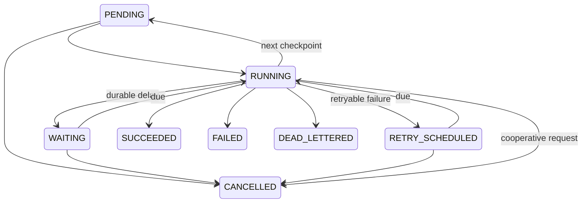

# Durable workflow engine (Phase 5)

Northstar’s CRM commercial job events enter the verified inbox, then a sequential workflow normalizes the job, checks a condition, performs an explicitly selected local connector action and records its result. Tenant identity comes from the stored webhook endpoint and composite foreign keys. Full CRM-to-ATS synchronization and conflict reconciliation remain Phase 7.

## Workflow JSON v1

`GET /api/v1/workflow-schema` returns the full strict Pydantic JSON schema. `POST /workflows/validate` also checks tenant-owned connections, connector operations and pinned mapping compatibility. Unknown fields, executable step types, arbitrary reference paths, duplicate IDs, forward references and out-of-bounds policies are rejected. Workflows have at most 12 steps and a 14 KB serialized definition budget; the browser BFF limits requests to 16 KiB.

```json
{
  "schema_version": 1,
  "trigger": {
    "connection_id": "<tenant-owned CRM connection UUID>",
    "source": "synthetic_crm",
    "event_types": ["job.updated"],
    "event_id_prefix": "demo-workflow-"
  },
  "steps": [
    {"id":"normalize","type":"NORMALIZE_EVENT","config":{"mapping_version_id":"<immutable requisition mapping version UUID>"}},
    {"id":"condition","type":"CONDITION","config":{"reference":{"source":"step","step_id":"normalize","path":"normalized_data.title"},"operator":"EXISTS"}},
    {"id":"observe","type":"MOCK_CONNECTOR_ACTION","config":{"connection_id":"<CRM connection UUID>","operation":"record.search","payload":{"kind":"requisition"},"bindings":{"external_id":{"source":"event","path":"external_id"}}}},
    {"id":"result","type":"RECORD_RESULT","config":{"outcome":"OBSERVED","summary":"Synthetic job observed","canonical_id":{"source":"step","step_id":"normalize","path":"canonical_id"}}}
  ]
}
```

Replace descriptive UUID values with actual IDs; the schema does not accept those placeholder strings. Definitions are created inactive. Each new version and its trigger are insert-only, protected by PostgreSQL triggers against UPDATE/DELETE. Activation explicitly selects an existing version. Version numbers and digests preserve the plan captured by an execution; subsequent activation does not change in-flight plans. Deactivation prevents new dispatch but does not cancel existing executions.

| Step | Input/configuration | Checkpoint v1 | Effects |
|---|---|---|---|
| NORMALIZE_EVENT | Accepted event and immutable mapping version | Validated canonical envelope and attempt UUID | Phase 4 canonical normalization, identities and authority |
| TRANSFORM | Same pinned event/mapping contract | Validated canonical envelope; null attempt UUID | Preview evaluation only; no canonical write |
| CONDITION | Allowlisted event/prior-step path; EQ, NE or EXISTS | matched boolean | False can skip all remaining steps or continue |
| DELAY | 1–300 seconds | aware due_at | Persist WAITING; release lease/transaction |
| MOCK_CONNECTOR_ACTION | Tenant connection, fixed operation, validated payload/bindings | Existing ConnectorResult contract | Local synthetic action and durable receipt |
| RECORD_RESULT | Bounded summary/outcome; optional canonical ID reference | summary, outcome, canonical_id | Checkpoint only |

Reference allowlists and output contracts are code-owned in `app/schemas/workflow.py`. There is no expression evaluation, user script, dynamic import, URL transport or arbitrary graph. CRM/ATS read operations, synthetic Slack/email sends and calendar creation are supported; upsert/synchronization and generic REST are rejected. Fault injection is explicit synthetic configuration only: transient, permanent or simulated timeout, bounded failure count and Retry-After seconds. It never contacts a provider.

## Dispatch and transitions

The dispatcher selects accepted undispatched inbox rows `FOR UPDATE SKIP LOCKED`. It matches tenant, source connection, provider type, event type and optional event-ID prefix against active versions. All matching executions, initial steps, history and one dispatch receipt commit together. Unique constraints prevent duplicates. NO_MATCH is explicit; an authorized manual rescan can reconsider only NO_MATCH events. A previously dispatched event is not dispatched again when a new version activates. Batch size is 25.

The original Phase 3 inbox remains immutable with processing_status=PENDING; authoritative workflow consumption resides in `workflow_dispatch_records`. This preserves ingestion provenance and distinguishes accepted inbox state from workflow execution state. The Events page describes this distinction; inspect Executions for actual progress.

Legal execution transitions:



Steps move PENDING → RUNNING → SUCCEEDED / FAILED / RETRY_SCHEDULED / CANCELLED. Condition skips move PENDING → SKIPPED. Expired RUNNING steps may return to PENDING under a newly fenced lease, consuming the existing attempt budget. Completed steps and terminal executions never become runnable again. Replay creates a different execution.

## Worker and transaction boundaries

`python -m app.workers.runner` is a separate single-slot foreground process. No Redis, queue service or Docker application containers. Multiple local processes may cooperate through SKIP LOCKED claims. Each worker has an opaque UUID infrastructure heartbeat; no hostname/user identity is exposed. Poll interval defaults to 0.5 seconds; lease defaults to 30 seconds (15–120 allowed).

1. Dispatch transaction persists execution creation and inbox receipt.
2. Claim transaction persists RUNNING, step attempt, worker ID, random fencing token, heartbeat and lease expiration.
3. Effect transaction locks tenant then execution, verifies token/expiry and current principal permissions, executes a bounded local operation, validates output and commits its receipt/checkpoint/next state together.
4. On failure the effect transaction rolls back. A new fenced failure transaction persists a safe category, history, retry due time or terminal dead letter.

No transaction is held while polling/sleeping. DELAY commits a due time rather than sleeping. Local mock adapters use PostgreSQL only, so their effect belongs in the same transaction as the receipt. No external connector operation is performed under a database transaction. SQL statement and lock timeouts bound database work; elapsed step time and lease validity are checked before committing. Pure executors have finite inputs/operations, not interruptible arbitrary code. The largest step timeout is 10 seconds, below the minimum lease. Heartbeats are updated during claiming and completion; there is no background heartbeat thread or long-running external task in this phase.

Workflow creation/activation and every effect revalidate the creator’s active user, tenant membership and integration-management permission. Operations users receive executions:recover, without definition editing. Cancel/replay revalidate the acting operator under the tenant lock. Revocation prevents further business actions. Terminal authorization or transformation review failures are sanitized; no raw exception strings, event payloads or checkpoints appear in execution read APIs or logs. Stored checkpoints retain synthetic business evidence and are not encrypted at rest.

## HTTP API

All routes below have `/api/v1` prefix and derive tenant scope from the authenticated active tenant. GETs require operations:read. Mutations also require exact Origin and session-bound CSRF.

| Route | Method | Permission |
|---|---|---|
| /workflow-schema | GET | operations:read |
| /workflows, /workflows/{id} | GET | operations:read |
| /workflows | POST | integrations:manage |
| /workflows/validate | POST | integrations:manage |
| /workflows/{id}/versions | GET / POST | read / manage |
| /workflows/{id}/activate | POST | manage |
| /executions, /executions/{id} | GET | read |
| /executions/{id}/history, /retries | GET | read |
| /dead-letters, /worker-status | GET | read |
| /executions/{id}/cancel, /replay | POST | executions:recover |
| /workflow-dispatch | POST | manage |

List/history/retry/version endpoints support offset/limit (default 25, maximum 100); executions also accept validated state/workflow_id filters. Cross-tenant IDs are unavailable. Explicit serializers omit lease tokens, raw checkpoints and inputs. The BFF exposes only these exact routes and filters, never public signed ingress or arbitrary proxy destinations.

## Limits

Coarse tenant locking trades throughput for understandable local transaction semantics. No throughput benchmark, distributed leader election, autoscaling, provider exactly-once guarantee or production readiness claim. Stale worker heartbeat records remain as evidence; retention is future work. Mapping authority conflicts stop downstream actions and require review; no operator overwrite/reconciliation is added. An API unavailable to workers does not stop already authorized PostgreSQL execution. Real provider credential isolation, provider idempotency, outbox transport and unknown-outcome reconciliation require later designs.
