# Real local application screenshots

Captured with Playwright against the existing application in a separate synthetic portfolio database on 2026-10-16. No route mocking, image generation, fabricated metrics or image compositing was used. PNGs receive lossless compression only. The operator, organizations, records and reserved test addresses are synthetic; provider effects are local simulators and AI is deterministic mock. No real communication was sent.

The [manifest](manifest.json) records capture time, routes, dimensions, byte sizes and SHA-256 digests. Browser session state stayed in memory; credentials, browser chrome, local-machine paths and private delivery material are excluded. Captures are a moment of local fixture state, not a customer deployment. Human acceptance only enables a separate recovery preview.

[Reproduce the demo and captures](../../DEMO_WALKTHROUGH.md) · [Disclosures](../../PUBLIC_RELEASE_DISCLOSURES.md)

## 01 Dashboard

Overview with real API health and persisted synthetic tenant counts.

## 02 Connections

Configured CRM simulator and a real local health check.

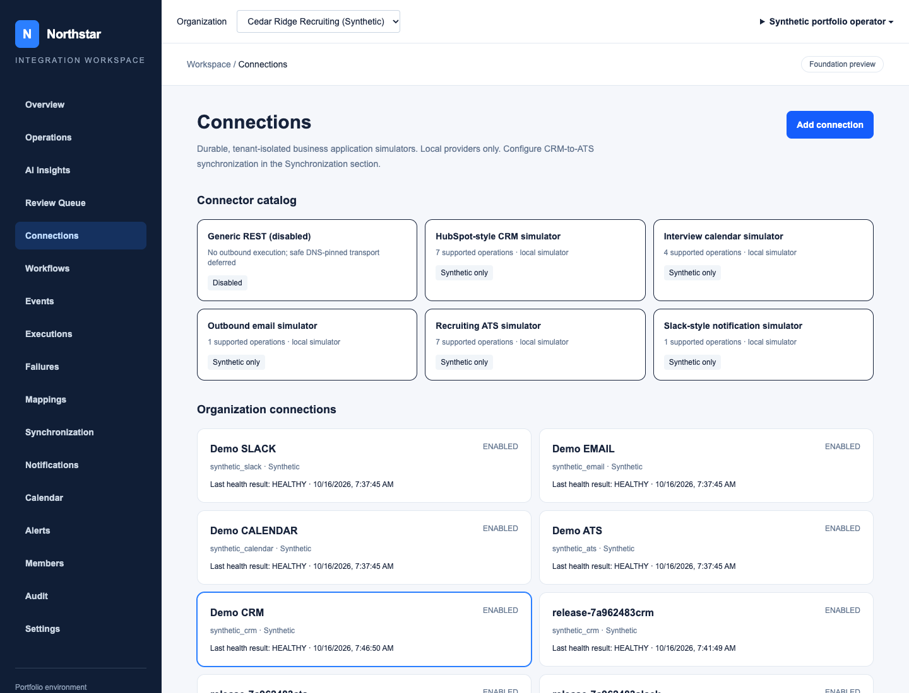

## 03 Events

Accepted signed synthetic event and durable ingestion provenance.

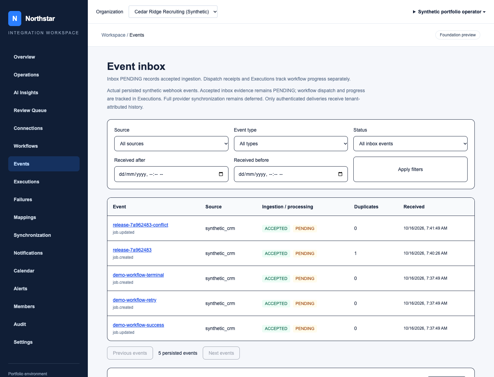

## 04 Workflows

Persisted versioned workflows; no invented provider integration.

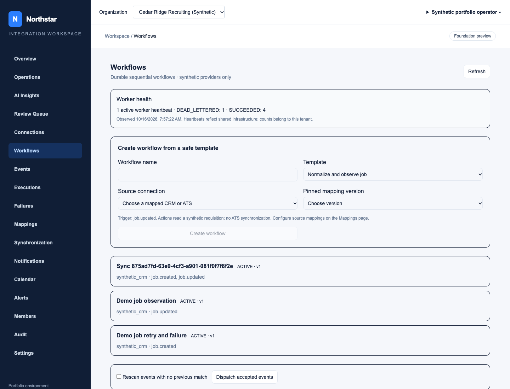

## 05 Executions

Actual successful synthetic workflow with checkpoint history.

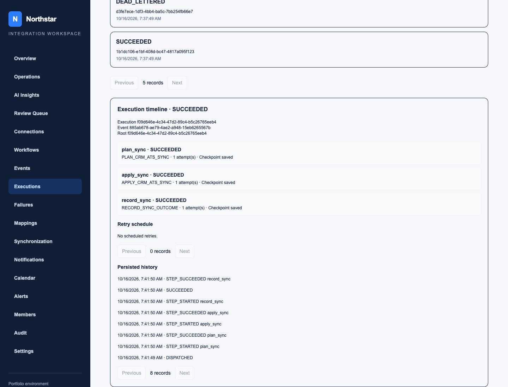

## 06 Synchronization

Committed sync decision and genuine held update from an independent ATS edit.

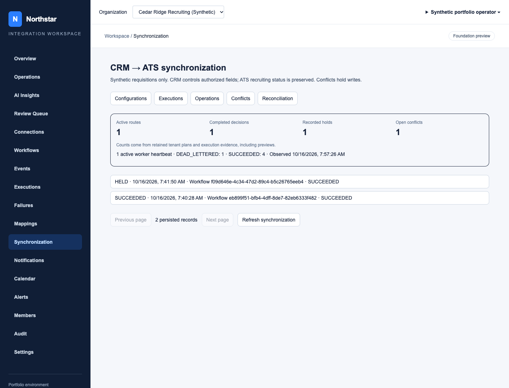

## 07 Conflict Review

Open destination-change conflict with before/after authority evidence; unresolved.

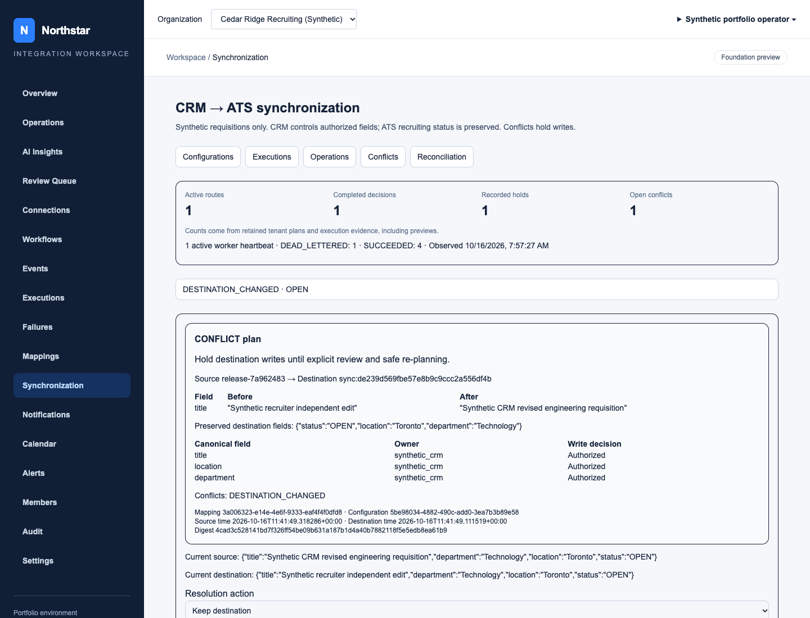

## 08 Notifications

Separate synthetic Slack/email delivery receipts after targeted retry.

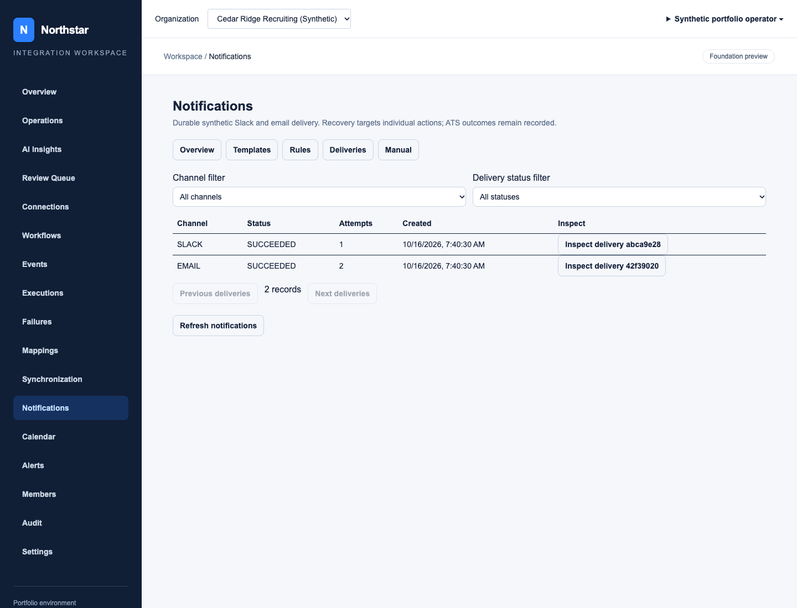

## 09 Calendar

Synthetic calendar coordination; no real invitation sent.

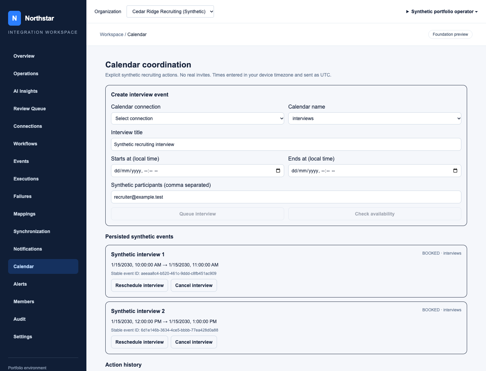

## 10 Operations

Observed tenant evidence and failure history from local fixtures.

## 11 Incident Timeline

Real correlated incident/workflow timeline with persisted provenance.

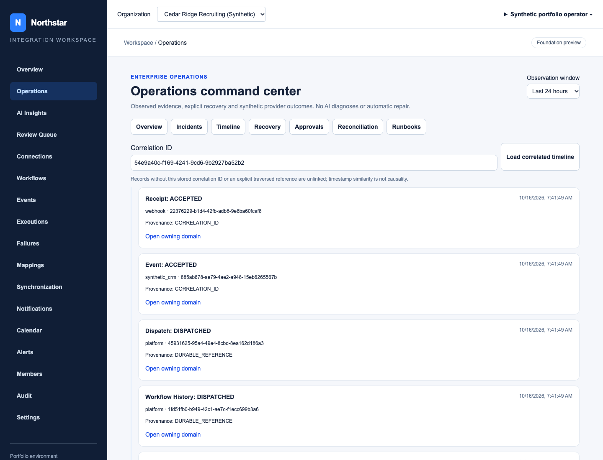

## 12 Ai Insights

SIMULATED deterministic mock analysis with authorized citations.

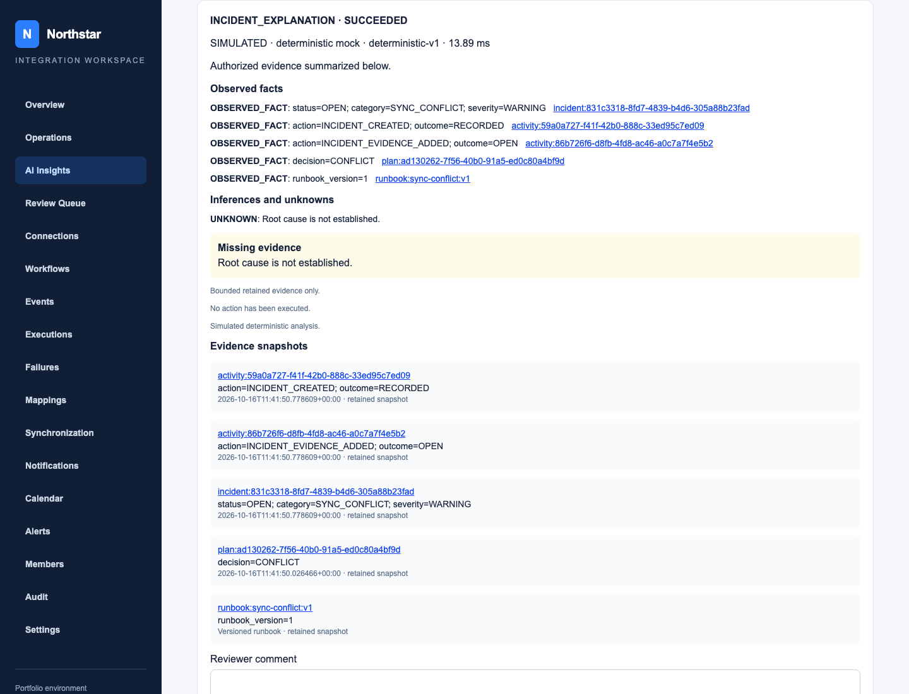

## 13 Human Review

Human review controls; accepting creates a preview only, not execution.

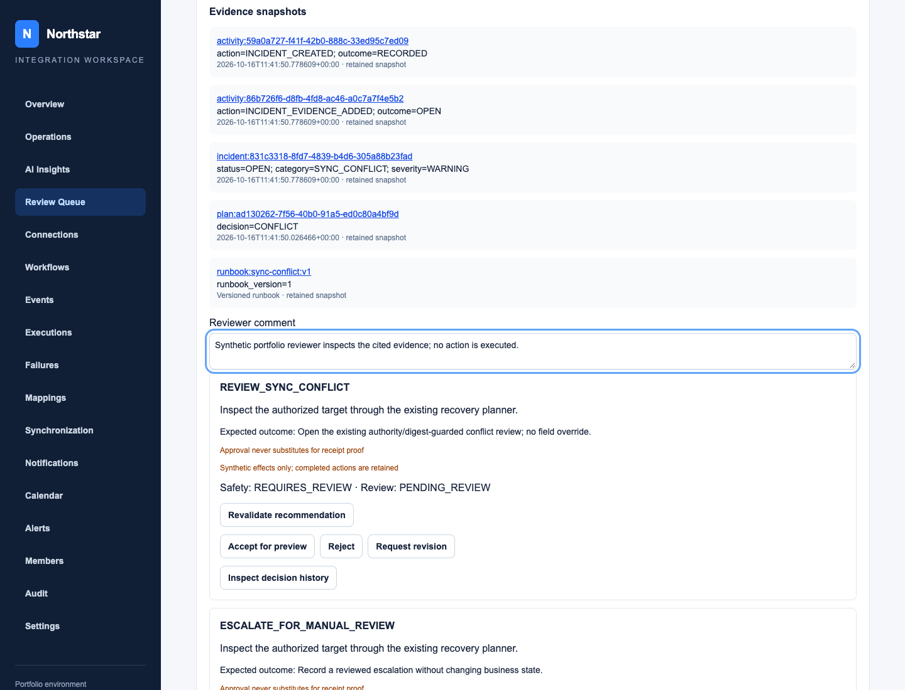
